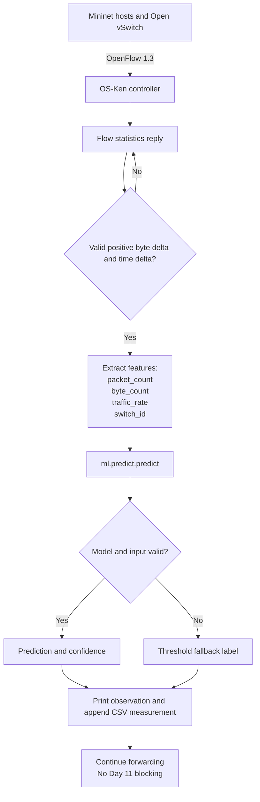

# Controller-to-model data flow

The Day 11 controller keeps the existing OpenFlow forwarding and flow-statistics
collection, then sends each valid measurement through the same feature contract
used during training.

## Runtime details

1. The controller requests flow statistics every five seconds.
2. The first observation for a flow establishes its counter baseline.
3. Subsequent positive counter deltas produce the four model features.
4. `ml.predict.predict` validates feature presence, numeric values, and
   non-negative values before loading the saved model.
5. Missing models, invalid inputs, or inference errors switch the controller to
   the threshold-label fallback.
6. Predictions are observational in Day 11. Traffic continues forwarding even
   when the model reports high-risk traffic.

## Automatic recovery

The integrated controller also handles `EventOFPPortStatus` notifications for
the redundant topology. A failed inter-switch port removes its switch edge
from `PathManager`, and the next available route between switches 1 and 4 is
selected without involving ML classification. The controller installs
bidirectional IPv4 rules for the protected h1-h4 flow on every connected
switch in that route and verifies recovery by counting the expected rules.
Each attempt is appended to `logs/recovery_events.csv` with the failed link,
paths before and after failure, recovery time, final rule count, and a
packet-loss measurement field for the traffic experiment.
